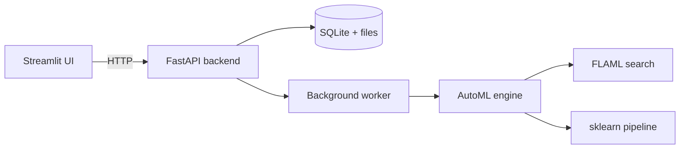

# Free AutoML

A free, open-source AutoML platform you can run on your own machine. Upload a CSV, pick the column you want to predict, and the app cleans the data, searches across several models, ranks them on a leaderboard and lets you make predictions, all from a web UI.

It is inspired by Azure Machine Learning's AutoML, built entirely from free tools: [FLAML](https://github.com/microsoft/FLAML), scikit-learn, FastAPI and Streamlit. No cloud account and no paid services are needed.

> **Status:** early stage. Phase 1 (core engine, API and UI) is done. See the [roadmap](#roadmap) for what's next. Contributions are very welcome.

<!-- Add a screenshot or GIF of the UI here, for example: -->
<!--  -->

## Features

- Upload any CSV and choose a target column
- Automatic task detection: classification or regression (you can override it)
- Automatic preprocessing: missing values, categorical encoding and scaling
- Searches LightGBM, XGBoost, Random Forest, Extra Trees and L1 logistic regression using cross-validation
- Leaderboard with cross-validation scores, plus an honest score on held-out test data
- Single and batch (CSV) predictions
- Downloadable trained model (a single scikit-learn pipeline in `.joblib` format)
- Background training with live progress, so the UI never freezes
- Everything runs locally with SQLite and plain files; nothing leaves your machine

## How it works



For each experiment the engine does the following:

1. Loads the CSV and drops rows with a missing target.
2. Detects the task from the target column.
3. Drops unusable columns: constant ones, ones that are more than 60% missing, and ID-like ones where almost every value is unique.
4. Splits off a hold-out test set (20% by default). The search never sees it.
5. Fits the preprocessor on the training split only, to avoid data leakage:
   - numeric: median imputation, then standardisation
   - categorical: most-frequent imputation, then one-hot encoding (rare categories are grouped together, and unseen categories at prediction time don't crash)
6. Runs a time-limited FLAML search with 5-fold cross-validation.
7. Bundles the preprocessor and the best model into **one** pipeline, so prediction only needs raw columns.
8. Scores that pipeline on the hold-out set and saves the model, leaderboard and metadata.

## Quick start

Requires Python 3.10 or newer (developed and tested on 3.12).

```bash
git clone https://github.com/<your-username>/<your-repo>.git
cd <your-repo>

python -m venv .venv
source .venv/bin/activate        # Windows: .venv\Scripts\activate
pip install -r requirements.txt
```

Start the backend and the UI in two terminals, both from the project folder:

```bash
# Terminal 1: backend (interactive API docs at http://localhost:8000/docs)
uvicorn api.main:app --port 8000

# Terminal 2: UI (opens at http://localhost:8501)
streamlit run ui/app.py
```

## Using the UI

1. **Train:** upload a CSV (or pick one you uploaded before), choose the target column, review the detected task and any warnings, then set the metric, models, search time and test split. Click **Start training**.
2. **Experiments:** watch progress while it trains. When it finishes you get the best model, cross-validation and test scores, the leaderboard, the best settings per model and a model download link.
3. **Predict:** fill in a form for a single prediction, or upload a CSV for batch predictions and download the results.

## Using the engine as a Python library

The `automl/` package has no web dependencies, so you can also call it directly from your own code or notebooks. Runs are saved to `artifacts/` by default (change it with `output_dir`).

```python
import pandas as pd
from automl import run_automl, load_model, predict

result = run_automl("data.csv", target="price", time_budget=120)
print(result["leaderboard"])

bundle = load_model(result["run_dir"])
preds = predict(bundle, pd.read_csv("new_data.csv"), with_proba=True)
```

## API overview

The backend is a standard FastAPI app. Full interactive documentation is at `/docs` when it is running.

| Method | Endpoint | Purpose |
|---|---|---|
| GET | `/health` | Health check |
| GET | `/options` | Available metrics and models per task |
| POST | `/datasets` | Upload a CSV |
| GET | `/datasets` | List datasets |
| GET | `/datasets/{id}/preview` | First rows of a dataset |
| GET | `/datasets/{id}/profile?target=` | Detected task, usable columns and warnings |
| POST | `/experiments` | Start a training job |
| GET | `/experiments` | List experiments |
| GET | `/experiments/{id}` | Status, progress and results |
| GET | `/experiments/{id}/leaderboard` | Ranked models |
| GET | `/experiments/{id}/model` | Download the trained model |
| POST | `/experiments/{id}/predict` | Predict from JSON rows |
| POST | `/experiments/{id}/predict/file` | Predict from an uploaded CSV |

Example:

```bash
# Upload a dataset
curl -F "file=@data.csv" http://localhost:8000/datasets

# Start training
curl -X POST http://localhost:8000/experiments \
  -H "Content-Type: application/json" \
  -d '{"dataset_id": "ds_xxxxxxxx", "target": "price", "time_budget": 60}'

# Check on it
curl http://localhost:8000/experiments/exp_xxxxxxxx
```

## Project structure

```
.
├── requirements.txt
├── automl/                 # the AutoML engine (no web dependencies)
│   ├── data.py             # loading, task detection, column typing
│   ├── preprocess.py       # imputation, scaling, encoding
│   ├── search.py           # FLAML search and leaderboard
│   ├── evaluate.py         # hold-out metrics
│   ├── trainer.py          # end-to-end orchestration and saving
│   └── predict.py          # load a saved run and predict
├── api/                    # FastAPI backend
│   ├── main.py             # endpoints
│   ├── store.py            # SQLite + file storage
│   ├── jobs.py             # background training worker
│   └── schemas.py          # request models
└── ui/
    └── app.py              # Streamlit front-end
```

## Configuration

| Variable | Default | Meaning |
|---|---|---|
| `AUTOML_HOME` | `./storage` | Where datasets, models and the database are stored |
| `AUTOML_API_URL` | `http://localhost:8000` | Backend address used by the UI (also editable in the UI sidebar) |

## Current limitations

- Tabular data only (classification and regression). No text, image or time-series tasks yet.
- Training jobs run one at a time and cannot be cancelled once started.
- No authentication or per-user separation, so don't expose it to the public internet as is.
- The leaderboard ranks model families, not every individual trial.
- Storage is local, so hosts with temporary disks will lose data on restart.

## Roadmap

- [x] Core AutoML engine (preprocessing, search, leaderboard, saved pipeline)
- [x] FastAPI backend with background jobs
- [x] Streamlit UI for training, results and predictions
- [ ] MLflow experiment tracking and model registry with versions
- [ ] Per-trial logging and richer comparison charts
- [ ] Explainability: feature importance and SHAP
- [ ] Data profiling report
- [ ] Docker image and free deployment guides (Hugging Face Spaces, Google Cloud Run, Render)
- [ ] Job cancellation and a proper queue
- [ ] Authentication
- [ ] Time-series forecasting
- [ ] Automated tests and CI

## Contributing

Contributions of every size are welcome: bug reports, ideas, documentation fixes and code.

1. Fork the repo and create a branch: `git checkout -b my-change`
2. Make your change and try it end to end (train a model from the UI).
3. Open a pull request describing what you changed and why.

Good places to start:

- Add automated tests (there are none yet, so this is very valuable)
- Add a new model family or metric in `automl/search.py`
- Improve error messages or the UI
- Pick an item from the roadmap above, and open an issue first so we can talk it through

If you are unsure whether an idea fits, open an issue and ask.

## Acknowledgements

Built on top of [FLAML](https://github.com/microsoft/FLAML), [scikit-learn](https://scikit-learn.org), [LightGBM](https://github.com/microsoft/LightGBM), [XGBoost](https://github.com/dmlc/xgboost), [FastAPI](https://fastapi.tiangolo.com) and [Streamlit](https://streamlit.io).

## License

MIT. Add a `LICENSE` file to the repo root before publishing.